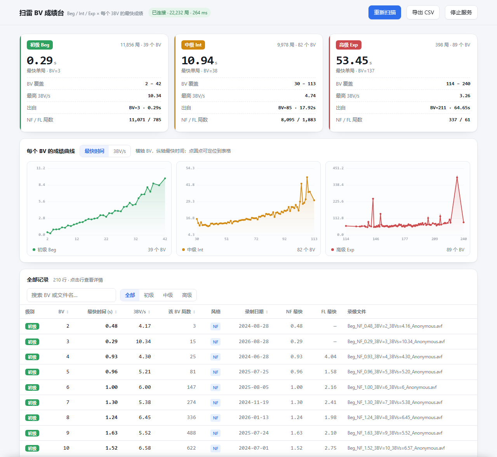

# 扫雷 BV 成绩台

按 **3BV** 分组查看自己的扫雷最快成绩——哪一档局面是真的快，哪一档只是抽到了好局。

读取扫雷（Arbiter / 阿比特）的录像目录，把 **初级 / 中级 / 高级** 下每个 **3BV 值** 的最快单局挑出来，
用一张本地网页展示。纯 Python 标准库，零依赖，只读你的录像，不改任何文件。



---

## 为什么按 BV 分组看

3BV（也叫 BBBV）衡量一局的"盘面复杂度"：不标雷（NF）打法下，最少需要点开多少次左键。
同样是初级，`3BV=3` 和 `3BV=42` 根本不是一回事。

所以「初级最快 0.29 秒」这种数字说明不了水平——它大概率是抽了个 3BV=3 的白给局。
真正能看出进步的是曲线：**BV=20 时你快了多少，BV=35 时是不是还稳得住**。

这个工具把全部录像按 `(级别, BV)` 分档，每档取最快一局，画成曲线，并列出明细。

---

## 快速开始

### 方式 A：不想装 Python（推荐）

去 [Releases](https://github.com/Corday-nkusky/ms-bv-viewer/releases) 下载 **`ms-bv-viewer.exe`**（约 8.6 MB），
直接丢进扫雷目录，双击就能用：

```
D:\你的扫雷目录\
├── Arbiter.exe
├── replays\           ← 录像
├── replays2\          ← 录像
├── stats.csv
└── ms-bv-viewer.exe   ← 就放这一个文件
```

黑窗口起来后浏览器自动打开页面，数据已经扫好了。关掉黑窗口（或页面右上角「停止服务」）即结束。

> 这个 exe 是自带的，**不需要安装 Python，也不需要装任何运行库**。
> 首次运行 Windows 可能弹「已保护你的电脑」——因为 exe 没有买代码签名证书，点
> 「更多信息」→「仍要运行」即可。杀毒软件偶尔会误报 PyInstaller 打包的程序，加白名单就行。

### 方式 B：有 Python 环境

需要 Python 3.8 或更高。Windows 上去 [python.org](https://www.python.org/downloads/) 装，
安装时**勾上 "Add Python to PATH"**。

然后把这个文件夹放进扫雷目录（和 `replays` / `replays2` 同级），双击 `启动.cmd`：

```
D:\你的扫雷目录\
├── Arbiter.exe
├── replays\
├── replays2\
└── ms-bv-viewer\      ← 本仓库整个放这里
    ├── 启动.cmd
    ├── server.py
    └── app.html
```

> 从 GitHub 下载：绿色 `Code` → `Download ZIP`，解压后把整个文件夹丢进扫雷目录。
> 文件夹叫什么名字都行，程序会自己往上找 `replays`。

macOS / Linux 用 `./start.sh`（同样需要 Python）。

### 方式 C：自己打包 exe

改了代码想重新打包，双击 `build.cmd`（需先有 Python），产物在 `dist\ms-bv-viewer.exe`。

---

## 录像不在扫雷目录里？

用参数指定：

```bash
python server.py --root "D:\Arbiter"
```

程序启动时会打印它实际扫的是哪个目录（页面页脚也有），扫错了一眼就能看出来。

自动查找顺序：程序自己的目录 → 往上 3 层的父目录 → 同级的兄弟目录 → 放弃并提示。

---

## 页面上有什么

- **三张汇总卡**：各级别最快单局、BV 覆盖范围、最高 3BV/s 及出自哪一局、NF/FL 局数
- **三条曲线**（初级 / 中级 / 高级）：横轴 BV，纵轴最快时间或 3BV/s；悬停看数据点，点圆点跳到表格
- **全量表**：按 BV / 时间 / 3BV/s / 局数 / 日期排序，搜索 BV 或文件名，按级别筛选；
  点一行看完整路径（可复制）
- **导出 CSV**、**重新扫描**

服务每 20 秒比对一次目录指纹，刚打完的局会自动出现在页面上，不用手动刷新。

---

## 数据口径

| 项 | 定义 |
|---|---|
| BV | 就是 3BV / BBBV，取自录像文件名 |
| 3BV/s | BV ÷ time |
| 时间 | 文件名里的两位小数（Arbiter 的 `rtime`，从 0 秒起算） |
| 记录 | 同一级别 + 同一 BV 下 `time` 最小的那一局 |
| 排名 | 主表 NF / FL **混合**排名，另给 `NF 最快` / `FL 最快` 分风格列 |
| 日期 | 从 `.avf` 头部内嵌的时间戳读，不是文件修改时间 |
| 校验 | 逐条读记录录像尾部的 `RealTime:` 字段，和文件名比对 |

同名的录像在多个目录里出现（比如 `replays2\replays\` 里有副本）只算一次。

---

## 参数

```
--root <路径>   扫雷目录（默认自动查找）
--port <端口>   监听端口，默认 8765，被占用时自动往后找
--no-open       不自动打开浏览器
```

exe 和源码都支持，例如：

```bat
ms-bv-viewer.exe --root "D:\我的扫雷"
python server.py --root "D:\我的扫雷"
```

服务只监听 `127.0.0.1`，不对外网开放。

---

## 常见问题

**页面提示「没找到任何 .avf 录像」**
说明扫错了目录。检查本程序是否和 `replays` / `replays2` 同级，或者用 `--root` 指定。

**双击 `启动.cmd` 一闪就没了**
多半是没装 Python 或没加进 PATH。在命令行里运行 `python --version` 确认一下。
如果用的是 exe 版，本身不需要 Python，闪退多半是被杀毒软件拦了。

**exe 支持哪些系统？**
只打了 Windows 64 位（扫雷客户端本身也是 Windows 的）。macOS / Linux 用源码版的 `start.sh`。

**会不会改我的录像？**
不会。全程只读，不写、不移动、不删除你的任何文件。导出 CSV 由浏览器另存。

**支持 NF 以外的打法吗？**
支持。文件名里的 `NF` / `FL` 会分开统计，主表混合排名，另有分风格最优列。

**需要联网吗？**
不需要，全部计算都在本地。

---

## 实现要点

| 文件 | 作用 |
|---|---|
| `server.py` | 纯标准库 HTTP 服务：扫描、统计、缓存、API、CSV 导出 |
| `app.html` | 单页前端，无外部依赖（图表是手写 canvas） |
| `启动.cmd` | Windows 双击启动，自动找 `py` 或 `python` |
| `start.sh` | macOS / Linux 启动脚本 |
| `build.cmd` | 用 PyInstaller 打成单文件 exe，产物在 `dist\` |

接口：`/api/records`（全量数据）、`/api/version`（目录指纹）、`/api/rescan`（强制重扫）、
`/api/csv`、`/api/shutdown`。

缓存策略：每次请求先算目录指纹（文件数 + 总字节 + 最大 mtime），变了才重新扫描。

---

## 已知限制

- **不重新计算 BV**：直接采用文件名里的 3BV 值，不解析 `.avf` 的二进制棋谱去重算。
  如果文件名被人为改过，表里就会是错的。
- **时间精度 0.01 秒**：`0.290` 和 `0.294` 在表里都记作 `0.29`，不区分名次。
- `3BV/s` 用「BV ÷ 文件名时间」算，和某些软件的四舍五入方式可能差最后一位。

---

## 许可

[MIT](LICENSE)
